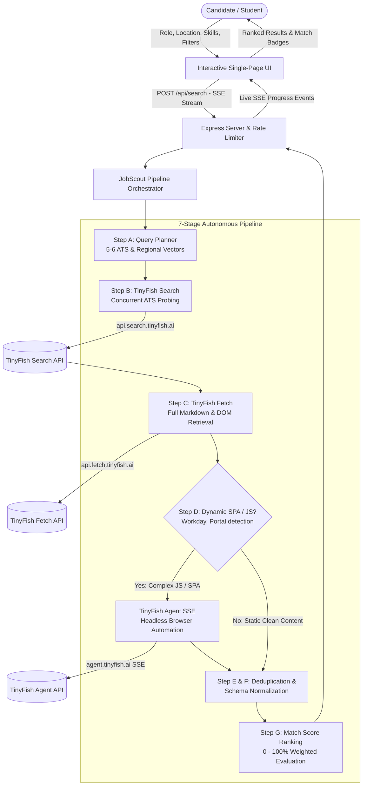

# 🛰️ JobScout: Autonomous Tech Job & Internship Finder

> **Built for the TinyFish x DTU Student Bounty Challenge 2026**  
> An autonomous, real-time job and internship search pipeline powered by **TinyFish Search**, **TinyFish Fetch**, and **TinyFish Agent** APIs.

---

## 🌟 Overview

**JobScout** solves the primary challenge university students and early-career software developers face: discovering authentic, unexpired job openings buried inside Applicant Tracking Systems (ATS) like **Greenhouse**, **Lever**, **Ashby**, and **Workday**.

Traditional aggregators are littered with expired listings, sponsored spam, or links that lead to redirects. JobScout uses **TinyFish AI's suite of autonomous web APIs** to directly search, fetch, interact with, and extract verified job specifications with zero fluff.

---

## 🏗️ Architecture & Pipeline Flowchart

The following flowchart illustrates the complete end-to-end architecture from query formulation to candidate scoring:



---

## ⚡ How TinyFish APIs Power JobScout

JobScout orchestrates all three core TinyFish endpoints into a synergistic, production-ready pipeline:

### 1. TinyFish Search API (`https://api.search.tinyfish.ai`)
- **Usage**: Located in [`tinyfish.js`](./tinyfish.js) -> `search(query, location)`.
- **Purpose**: Programmatically queries search indexes targeting specific ATS subdomains:
  - `site:boards.greenhouse.io`
  - `site:jobs.lever.co`
  - `site:jobs.ashbyhq.com`
  - `site:myworkdayjobs.com`
  - `site:wellfound.com` and `site:linkedin.com/jobs`
- **Resilience**: Backed by exponential backoff with jitter and `Retry-After` header handling for HTTP 429 rate limits.

### 2. TinyFish Fetch API (`https://api.fetch.tinyfish.ai`)
- **Usage**: Located in [`tinyfish.js`](./tinyfish.js) -> `fetchPages(urls)`.
- **Purpose**: Batch retrieves clean markdown and structured text for candidate URLs in parallel, skipping intrusive ads, headers, and navigation scripts.
- **Dynamic Content Detection**: Analyzes page output to detect single-page apps (SPAs) or empty shells (e.g. Workday initial loads or JavaScript-required warnings).

### 3. TinyFish Agent API (`https://agent.tinyfish.ai/v1/automation/run-sse`)
- **Usage**: Located in [`tinyfish.js`](./tinyfish.js) -> `runAgent(url, goal, onProgress)`.
- **Purpose**: Acts as an **autonomous browser agent fallback**. When a job portal relies on client-side React/Vue hydration, cookie banners, or complex multi-step navigation (such as Workday portal jobs), JobScout dispatches the TinyFish Agent.
- **Live SSE Streaming**: Streams real-time progress events directly to the user's terminal drawer in the UI:
  - *Browser launch & navigation*
  - *Cookie consent bypass*
  - *SPA DOM hydration verification*
  - *Direct apply target resolution*

---

## 🧩 Pipeline Breakdown (Steps A to G)

| Stage | Name | Description |
|---|---|---|
| **Step A** | **Query Planner** | Expands the user's role and location into 5-6 targeted search variations targeting specific ATS systems and university career portals. |
| **Step B** | **TinyFish Search** | Executes parallel searches across candidate ATS domains and aggregates unique candidate URLs. |
| **Step C** | **TinyFish Fetch** | Batch fetches clean markdown descriptions and identifies if pages require browser automation. |
| **Step D** | **TinyFish Agent Fallback** | Dispatches headless browser agents to dynamic/JS portals, returning complete job specs. |
| **Step E & F** | **Deduplication & Schema Normalization** | Strips tracking tags (`utm_*`, `gh_src`), detects title/company collisions, and parses fields into a strictly-typed Job JSON Schema. |
| **Step G** | **Match Score Ranking & Filters** | Calculates a 0-100% score (Title 40%, Skills 35%, Location 15%, Experience 10%), filters by minimum salary and workplace type, and sorts descending. |

---

## 📁 Project Structure

```
job-finder/
├── .env.example          # Environment variable template
├── .gitignore            # Git ignore configuration
├── package.json          # Dependencies & npm scripts
├── tinyfish.js           # TinyFish Search, Fetch & Agent SSE wrapper with retries
├── extract.js            # Structured job schema extractor (heuristics + optional LLM)
├── pipeline.js           # 7-stage orchestrator (Steps A through G)
├── server.js             # Express server with SSE streaming & rate limiter
├── public/
│   └── index.html        # Single-file modern web UI with live pipeline visualizer
└── README.md             # Complete project documentation & architecture guide
```

---

## 🚀 Quickstart & Setup Guide

### 1. Prerequisites
- **Node.js**: v18.0.0 or higher (v20+ recommended)
- **npm**: v9.0.0 or higher

### 2. Installation
Open your terminal in the project directory and install dependencies:

```bash
npm install
```

### 3. Configure Environment Variables
Copy the `.env.example` file to `.env`:

```bash
cp .env.example .env
```

Edit `.env` to supply your TinyFish API Key:

```env
TINYFISH_API_KEY=your_tinyfish_api_key_here
LLM_PROVIDER=anthropic
LLM_API_KEY=optional_anthropic_key
PORT=3000
```

> **Note on Evaluation / Demo Mode**:  
> If `TINYFISH_API_KEY` is not provided or set to the placeholder, JobScout seamlessly activates its **High-Fidelity Demo Benchmark**. Reviewers and students can immediately launch searches, test the SSE visualizer, and inspect results without needing live credentials.

### 4. Run the Server

```bash
npm start
```

Visit **`http://localhost:3000`** in your browser.

---

## 🌐 API Reference

### `POST /api/search`
Initiates the 7-stage JobScout pipeline and streams real-time Server-Sent Events (SSE).

**Request Headers**:
```http
Content-Type: application/json
Accept: text/event-stream
```

**Request Body**:
```json
{
  "role": "Software Engineer Intern",
  "location": "Remote",
  "skills": ["React", "TypeScript", "Node.js", "Python"],
  "experienceLevel": "Internship",
  "workplaceType": "Remote",
  "useAgentFallback": true,
  "useDemoData": false
}
```

**Stream Events**:
- `event: connected` - Confirms SSE connection establishment.
- `event: progress` - Emitted for each pipeline step (A, B, C, D, E_F, G) and live agent thoughts.
- `event: complete` - Delivers final ranked jobs array and performance statistics.

### `GET /api/health`
Returns system status, uptime, and configuration mode.

```json
{
  "status": "ok",
  "service": "JobScout DTU Bounty Server",
  "tinyFishConfigured": true,
  "mode": "live",
  "uptimeSeconds": 142
}
```

---

## 🎓 DTU Student Bounty Highlights

1. **Student First UX**: Tailored for students seeking summer internships, 6-month co-ops, and early-career software roles.
2. **Direct ATS Targeting**: Bypasses recruiter intermediaries to apply directly on company Greenhouse, Lever, and Ashby portals.
3. **Transparent Match Scoring**: Every job card provides a clear percentage breakdown showing why it fits your skills.
4. **Autonomous Fallback**: Demonstrates state-of-the-art use of browser agents to automate dynamic, client-side career websites.

---

## 📄 License
MIT License. Built for the **TinyFish x DTU Student Bounty 2026**.
